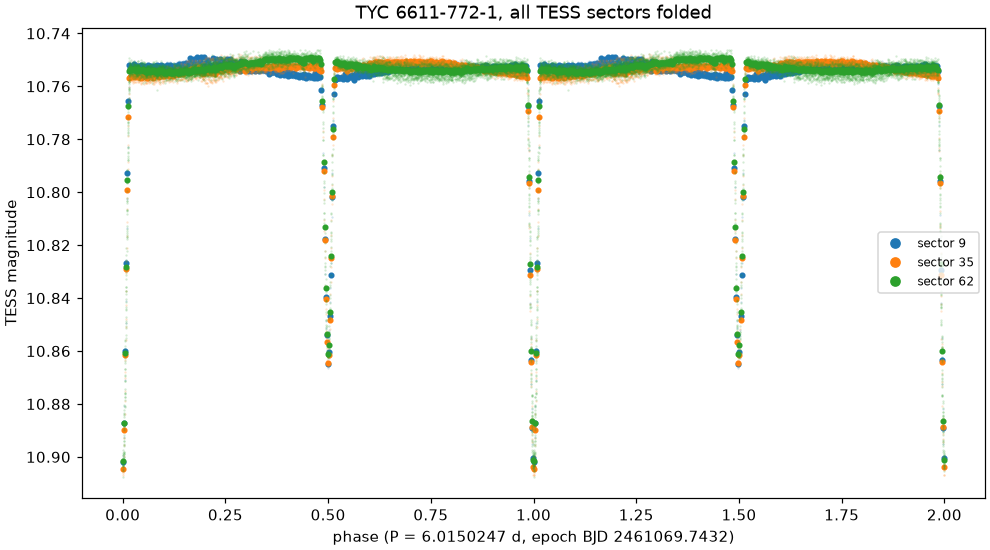

# varhunt

Finds variable stars that no catalogue lists yet in TESS full-frame images and prepares them for the AAVSO Variable Star Index.



*TYC 6611-772-1, a detached eclipsing binary in Hydra found by varhunt and submitted to VSX in October 2026. Three TESS sectors over four years, folded on one ephemeris.*

## Quick start

```bash
uv sync
uv run varhunt search 100.0 20.0 --radius 0.2    # one field in its latest TESS sector
uv run varhunt vet runs/s0072_100.000+20.000      # where in the pixels the signal sits
uv run varhunt confirm runs/s0072_100.000+20.000  # other sectors, catalogues and Gaia
uv run varhunt survey fields.csv                  # all of it for many ra,dec,radius fields
uv run varhunt sure runs/survey                   # every sure candidate in one list
uv run varhunt vsx runs/survey/<field> <TIC> --discoverer "Your Name"   # VSX draft and plots
```

Each run directory holds `summary.md`, the result CSVs and a plot per candidate. Downloads are cached in `~/.cache/varhunt`.

## How it works

1. **Light curves.** Raw aperture flux from the MIT Quick Look Pipeline, gently detrended.
2. **Signals.** Lomb-Scargle with prewhitening for pulsation and rotation, a box search for eclipses.
3. **Impostors.** Frequencies shared across the field, echoes of brighter neighbours and leftovers of slow drifts are thrown out.
4. **Pixels.** The signal is fitted to every pixel of a TESScut cutout and has to sit on the star, in more than one sector.
5. **Evidence.** Other sectors, the mission's own TESS-SPOC light curves, VizieR, SIMBAD and Gaia.

A candidate that passes everything is called sure. The details and the exact thresholds are in [docs/method.md](docs/method.md).

## How well it works

On 43 random catalogued variables it finds 36 periods within 1 % and 39 with half or double counted. Injected signals are recovered from 1 ppt for stars brighter than Tmag 12.

## Development

```bash
make check   # ruff and pytest, no network
```

MIT licensed.
